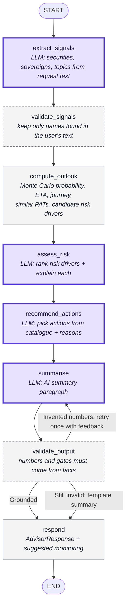
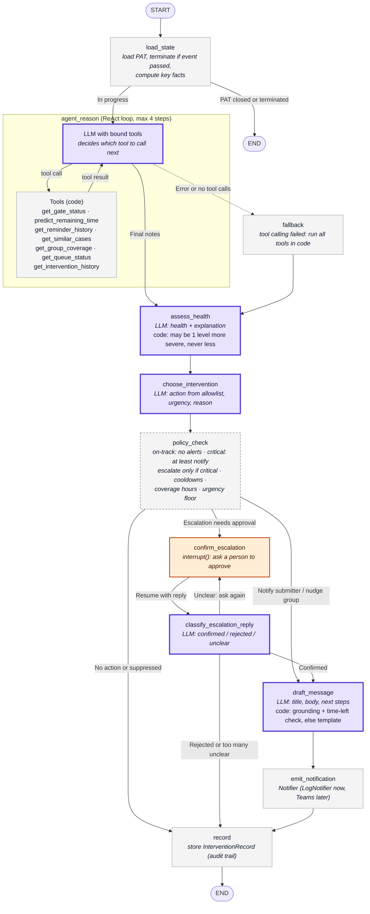

# PAT LangGraph workflows

Two graphs in `pat/`. Edges match the compiled graphs (`builder.compile().get_graph()`); keep this file in sync when edges change.

Legend:

- **Purple, bold border**: node calls the LLM.
- **Grey**: code only (no LLM).
- **Orange**: human-in-the-loop `interrupt()`.
- **Dotted border**: code checks that run on LLM output.

## Submission Advisor (`pat/advisor_graph.py`)

Single pass, no checkpointer. Endpoint: `POST /pat/advise`.

## Approval Intelligence Agent (`pat/monitor_graph.py`)

One checkpointed thread per PAT (`thread_id = "pat:<id>"`). Endpoints: `POST /pat/{id}/tick`, `POST /pat/{id}/resume`, `POST /pat/monitor/run`.

`agent_reason` is one LangGraph node; the subgraph shows the loop inside it.

## LLM call sites

| Graph | Node | LLM call | Output schema | What checks it |
|---|---|---|---|---|
| Advisor | `extract_signals` | `invoke_structured` | `SignalExtraction` | `validate_signals`: names must appear in the request text |
| Advisor | `assess_risk` | `invoke_structured` | `RiskRanking` (ids are a `Literal` of computed drivers) | Ungrounded "why" dropped; skipped drivers appended |
| Advisor | `recommend_actions` | `invoke_structured` | `ActionChoices` (ids are a `Literal` of the catalogue) | Ungrounded reason replaced with catalogue text |
| Advisor | `summarise` | `invoke_structured` | `AdvisorSummary` | `validate_output`: one retry, then template |
| Agent | `agent_reason` | `bind_tools` + `invoke` loop | Tool calls / notes | Unknown tools refused; step limit; fallback runs all tools |
| Agent | `assess_health` | `invoke_structured` | `HealthJudgement` | Severity band from statistics; grounding + time-left check |
| Agent | `choose_intervention` | `invoke_structured` | `InterventionChoice` (action is a `Literal` of the allowlist) | `policy_check` |
| Agent | `classify_escalation_reply` | `invoke_structured` | `EscalationReply` | Failure counts as unclear; limit then cancel |
| Agent | `draft_message` | `invoke_structured` | `DraftMessage` | Grounding + time-left check, else template |

Every call goes through `pat/llm.py`; if the model errors, each node falls back to code.
